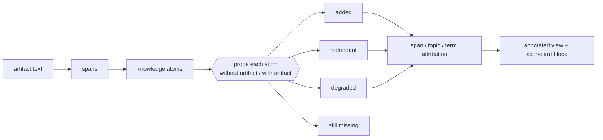

# Content novelty: what does this skill actually *add*?

The arm comparison answers *does this artifact help?* This layer answers the two questions an author
asks next: **which parts of it help, and which parts are the model repeating back to you?**

Both matter because a skill is not homogeneous. Measured on 33 skills (see
[skill-novelty-evidence.md](skill-novelty-evidence.md)): for `claude-opus-5`, **70% of what a skill
says is something the model already produces unprompted**, 21% is genuinely new, and 2% is knowledge
the model had and the skill destroyed. A single delta cannot separate those three.



## The four outcomes

Every knowledge atom in the artifact gets probed twice against the same model — once with no
artifact in context, once with it — and both answers are graded by a *different* model. The outcome
is one of four, and they are exhaustive:

| outcome | meaning | what to do about it |
|---|---|---|
| **added** | wrong without the artifact, right with it | this is the artifact's reason to exist — protect it |
| **redundant** | right both ways | delete it, for this model tier |
| **degraded** | right without, wrong with | a real defect: the text is overriding correct prior knowledge |
| **still_missing** | wrong both ways | the artifact says it but the model does not pick it up — rephrase or promote it |

Because the probes are paired per atom, the comparison is robust even when the judge's absolute
calibration is not. That distinction matters: two independent judges in the study agreed on a 6-way
verdict scale only 66% of the time, but 85% on the correct-ish binary collapse. **Trust the signs
and the rankings; do not trust the second decimal of a level.** Every number is therefore reported
twice, under a lenient and a strict grading.

## Novelty is a property of the pair, not of the file

The same artifact is worth very different amounts to different models:

| model | added | already knew | degraded |
|---|---|---|---|
| claude-opus-5 | 0.209 | 0.700 | 0.019 |
| gpt-5.6-luna | 0.131 | 0.775 | 0.030 |
| grok-4.6 | 0.307 | 0.537 | 0.024 |
| nemotron-nano-12b | 0.293 | 0.498 | 0.076 |

Consequences for authoring:

- A skill that looks bloated against a frontier model may be correctly sized for a small one. Decide
  which tier you are writing for, and record it.
- `degraded` rises as the model weakens (0.019 → 0.076). Weak models copy your errors; strong models
  overrule them. A stale line in a skill is a bigger risk to a small model — **except** for reversed
  or out-of-date claims, where the opposite holds: strong models resisted planted inversions *less*
  often (0.787–0.811) than weak ones (0.890), because a weak model abstains and thereby dodges the
  trap.

## Where "relevant" comes from: the need graph

`added` says the model learned something. It does not say the artifact should have taught it. That
second question needs a scope definition, and the scope must not come from the artifact — otherwise
every sentence is relevant by construction, because it is in the file.

So relevance is scored against a **need graph** built from the artifact's `name` and `description`
only. Nodes are the things a reader actually needs: `intent`, `decision`, `constraint`, `action`,
`evidence`. Each node gets a path class, and the class sets its weight:

| path class | weight | meaning |
|---|---|---|
| `core` | 1.0 | on the main path of the artifact's own task |
| `rare_critical` | 1.0 | fires rarely, prevents a bad outcome when it does |
| `branch` | 0.7 | a specific variant or configuration |
| `supporting` | 0.4 | helps, but nothing breaks without it |
| `out_of_scope` | 0.0 | a real need — for a *different* artifact |

`rare_critical` deliberately weighs the same as `core`. Frequency and criticality are separate axes,
and collapsing them is the mechanism by which safety text gets deleted: *"only triggers on driver
1.0, cut it"*.

**Why not just use embedding similarity to the topic?** Measured: graph-derived relevance correlates
with top retrieval similarity at only **0.368**, the two rankings disagree on 57% of the atoms they
each call most relevant, and 1.3% of atoms best-match an `out_of_scope` node — text answering a
question the artifact is not responsible for. Similarity can say *on-topic*. Only the graph can say
*in-scope*, and only in-scope licenses spending tokens.

**What the graph must not be asked to do.** It organizes the question space; it is a retrieval and
exploration layer, not the scorer. It cannot tell you whether a claim is true, how often the need
arises, what your model already knows, which span caused a behaviour change, or whether the knowledge
helps downstream. Those are five separate measurements — probes, arms, task suite — which is why the
output of this layer is a dashboard and not one graph score.

**The edges are where the value hides.** The highest-value content found in the study was not
propositions but *negative edges*: one-clause blocks on an inference the model would otherwise make —
"a successful import does not mean the array is on the GPU", "seeing MKL in `threadpool_info()` does
not mean NumPy's BLAS is wired to it", "fits in VRAM does not mean it will launch now". Cheap in
tokens, invisible to any frequency or perplexity ranking, expensive to lose. That is what the
`protection` axis and the amber colour exist for.

## Using it as an authoring tool

### 1. Whole-artifact triage

```bash
python cli.py novelty analyze --artifact skill:path/to/skill --model claude-opus-5 \
    --judge-model gpt-5.6-luna
```

Reports the 2×2, `K0`, the five-category content breakdown, the span statistics (how many tokens
carry no knowledge at all, how many spans are the sole carrier of something, how many are
protected), and the control arms.

Read it in this order:

1. **`routing` first.** If the description does not win the artifact's own queries, content work is
   unrecoverable spend. In the study six of thirteen skills routed below 0.50, one at 0.146.
   Routing is measured by the existing skill-selection track, not by `novelty analyze`, which
   holds the frontmatter fixed so the two are not confounded.
2. **`harmful_conflicting` next.** Conflicts are the only category that can make the artifact worse
   than nothing.
3. **`frac_carrying_nothing`.** Tokens that carry no extractable knowledge. Eleven of thirteen
   skills were ≤0.17; the outliers were 0.50 and 0.74.
4. **`added` last** — it tells you whether the artifact is worth its tokens, but the three checks
   above tell you what to do.

### 2. Span attribution — where in the file

Each span of the artifact is annotated with the atoms it carries, their outcome, and its token cost,
then rendered as the artifact's own text with colour:

| colour | meaning |
|---|---|
| green | carries `added` knowledge — the artifact's value |
| grey | carries only `redundant` knowledge — candidate for deletion |
| red | carries a `harmful_conflicting` or `degraded` atom |
| amber | **protected**: expresses a negation, version gate, ordering constraint, or threshold |
| white/dim | carries no extracted atom at all |

Two derived views an author acts on directly:

- **Dead weight**: the dim spans, sorted by token cost. The largest single win in most artifacts.
- **Sole carriers**: spans that are the only source of some atom. These are what a careless edit
  silently deletes; the shortener pins them.

### 3. Shortening, with five separate scores

```bash
python cli.py novelty shorten --artifact skill:path/to/skill --atoms atoms.json --budgets 0.75 0.5
```

Never one "retention" number, because a single score hides the one failure that matters. A measured
example from the study: a candidate at **21% of the original tokens** retained **0.916** of the
knowledge — and only **0.158** of the protected spans. Knowledge said "success"; the negations,
version gates and ordering constraints had been thrown away, because their value is conditional on a
failure the atom statement does not encode.

| axis | what it protects |
|---|---|
| `tokens` | the budget |
| `knowledge` | the atoms survive somewhere in the text |
| `value` | the *relevant and novel* atoms survive, weighted |
| `protection` | negations / gates / versions / orderings survive |
| `routing` | the description still claims the artifact's own queries |

Rule of thumb from the measurements: a safety-pinned strategy at 0.60 token fraction held
`protection = 1.000` with knowledge 0.81–0.96 and **no** measured task loss on strong models. Every
task-score loss worse than −0.08 in the study belonged to the smallest model. Small models need the
redundancy you can take away from large ones.

### 4. What the artifact should *not* teach

Two content patterns were measured as actively harmful, independent of topic:

- **Deferral phrasing.** "Consult `references/X` before answering" cost one model its answer
  entirely: it replied with a preamble promising to look things up and scored 0.047, against 0.537
  with no skill at all. Skill bodies should be answerable standalone; progressive disclosure is a
  loading strategy, not a sentence to write.
- **Investment in prose order.** An arm with the same spans in shuffled order scored *higher* than
  the intact artifact on four of five models. Ordering, transitions and narrative framing carried no
  measurable knowledge. Spend the effort on facts, qualifiers and exact values — that is where the
  strict-grading `added` lives.

## Comparing knowledge: which matcher is allowed to answer

Two steps ask "is this the same knowledge?" — the retention oracle ("does the shortened text still
carry atom `A`?") and the atom↔need match ("does `A` answer need `N`?"). Measured on 714 constructed
pairs (restates / entails / unrelated / **reverses**):

| approach | macro-F1 | LLM calls | catches a reversal? |
|---|---|---|---|
| llm_direct | 0.953 | 100% | yes |
| **hybrid — retrieval → NLI → LLM band** | 0.848 | **25.6%** | yes |
| nli only | 0.732 | 0% | sometimes |
| graph structure matcher | 0.551 | 0% | — |
| lexical overlap | 0.446 | 0% | **no (recall 0.00)** |
| embeddings (potion / bge) | 0.444 / 0.438 | 0% | **no (recall 0.00)** |

The hybrid ships. Two consequences worth remembering when reading a `knowledge` number:

- **Never accept an embedding-only retention score.** Both cheap matchers scored 0.00 recall on the
  contradiction label: they cannot tell *restates* from *reverses*, so a rewrite that inverted a rule
  would be reported as faithfully retained.
- **The oracle fails safe.** With no adjudicator configured, the ambiguous band resolves to *absent*,
  so reported `knowledge` is a floor — a shortening can look worse than it is, never better.

The graph matcher's 0.551 is not an argument against the graph. Structural overlap is the wrong
instrument for semantic equivalence; the graph's job is the step before, deciding which question is
being asked at all.

## Cost, and how it is kept down

The measurement is LLM-call bound: `atoms × probes × arms × (answer + grade)`. Defaults therefore
sample — atoms are capped per artifact and each atom gets two paraphrases — and the artifact records
exactly what was sampled, so a number is never quoted as if it were a full sweep. The retention
oracle runs retrieval → NLI locally and escalates to an LLM only for the ambiguous band, with a
disk cache keyed on (atom, text). Full sweeps are opt-in.

## Limits to state when quoting these numbers

- **Extractor recall is unmeasured.** Faithfulness of the extracted atoms was verified; recall was
  not. Knowledge the extractor missed is invisible to every number — including "dead tokens", part
  of which may be knowledge it could not formalize. Treat `frac_carrying_nothing` as an upper bound
  on waste.
- **Judge calibration.** See above: signs and rankings, not second decimals.
- **The need graph has a 14% noise floor** (author/critic path-label agreement was 86%), which
  propagates into relevance-weighted `value`.
- **Need frequency is assumed uniform.** Nothing here measures how often each need actually arises,
  so `value` ranks atoms *within* one artifact and must not be compared across artifacts. Real query
  or issue traffic is what closes that, not another judge.
- **Category boundaries are judged, not measured.** An independent reviewer agreed with the
  five-category assignment on 72% of atoms; the disagreements concentrate on useful-vs-inert
  (±3 points) and known-vs-novel (±2 points). The scaffolding share is the most robust of them.

## See also

- [skill-novelty-evidence.md](skill-novelty-evidence.md) — the 33-skill study these numbers come
  from, with its method and its caveats.
- [evaluating-treatments.md](evaluating-treatments.md) — the arm framework this layer consumes.
